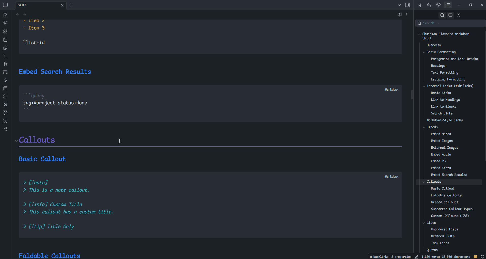
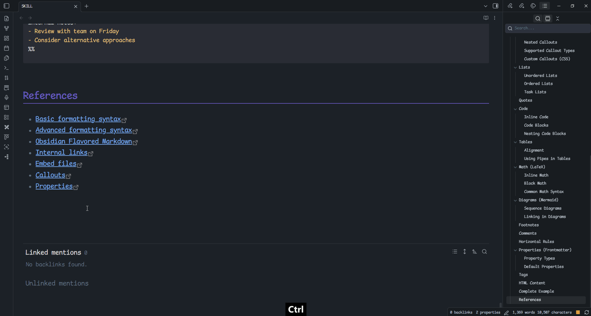
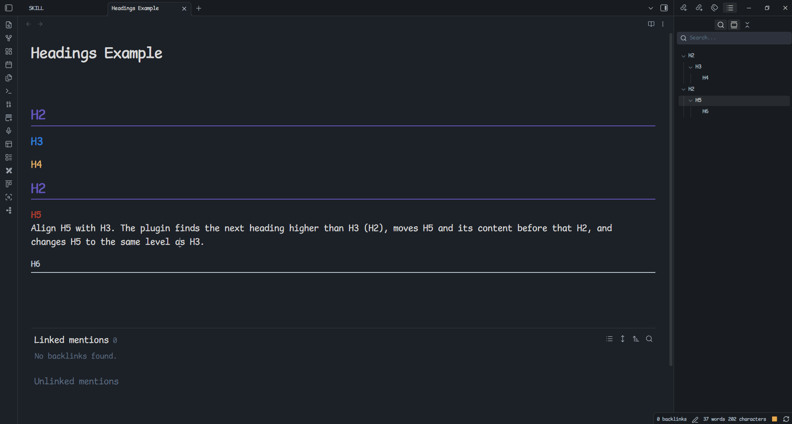
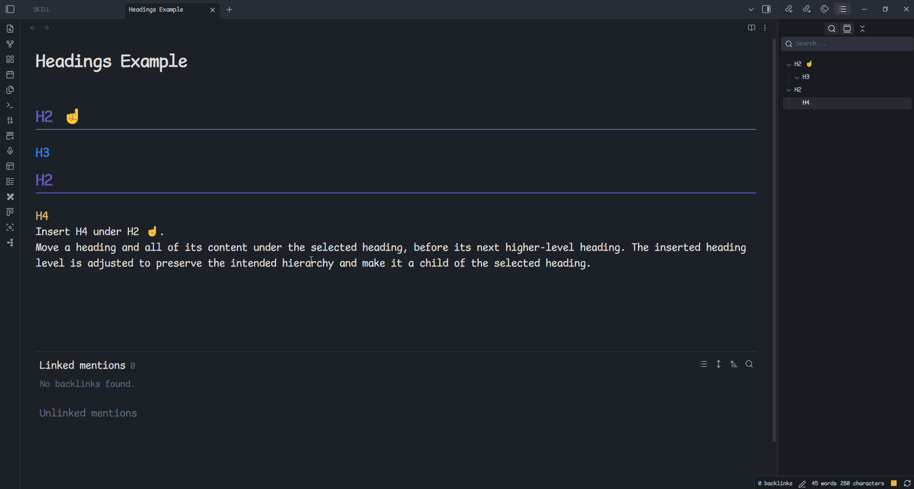
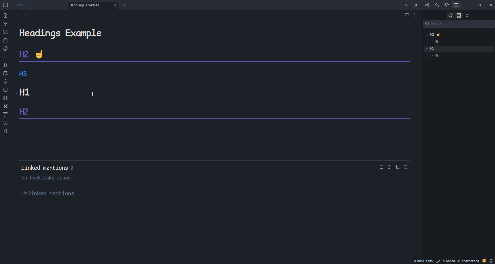
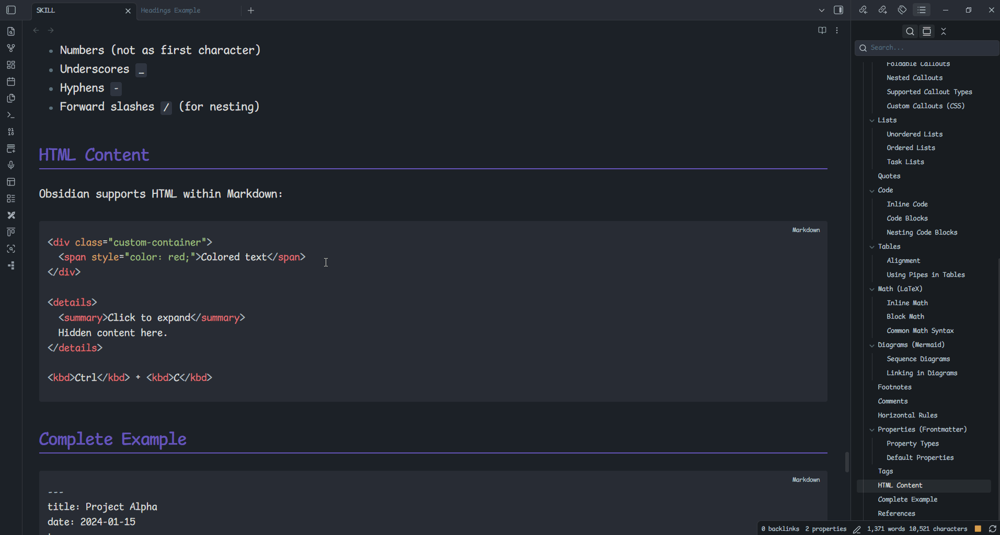
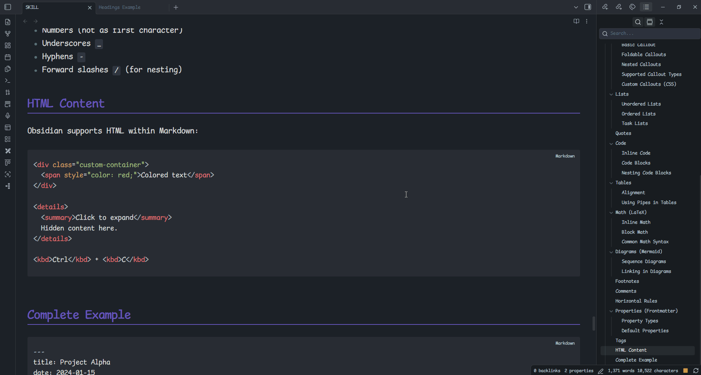
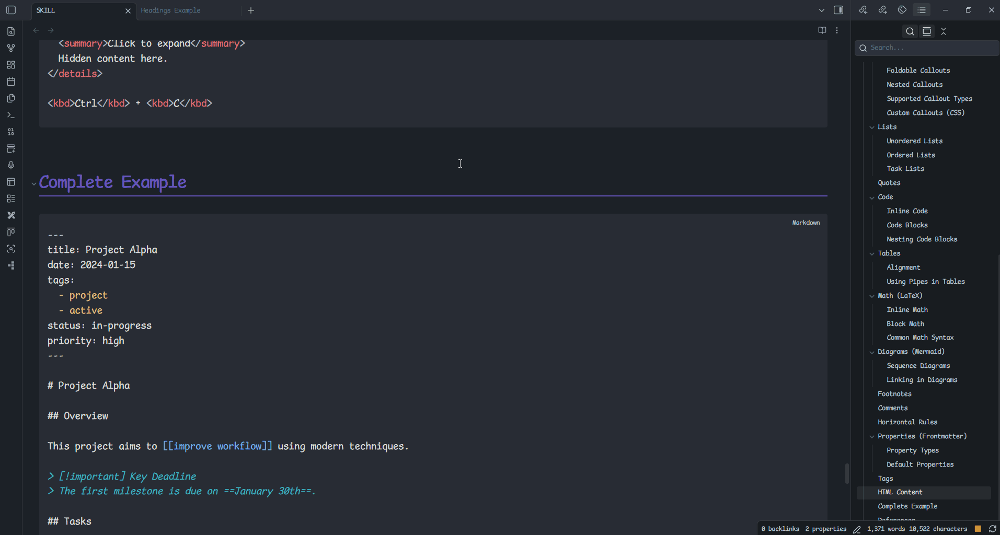

# Headings

[English](README.md) | [繁體中文](README.zh-TW.md) | [简体中文](README.zh-CN.md) | [日本語](README.ja.md) | [한국어](README.ko.md) | [Español](README.es.md) | [Français](README.fr.md)

A plugin for looking at a Markdown document from different angles.
A note is a mind map: the headings, lists and other sections it already has are redrawn as one picture of the whole structure, so you can take in the key points and the shape of the note at a glance.

Once you see what needs fixing, do it right on the map: collapse the branches you don't care about, double-click a node to change its text, drag a whole section under another chapter. Every change is written back to the note, so there is no scrolling up and down the editor to cut and paste.
There is also a set of editor commands for going to, copying and moving headings, or straightening out heading levels that have drifted, without opening the view.


[](https://ko-fi.com/B0B37J4BG)

## Headings view

<!-- Screenshots to add: doc/img/headings_view_mindmap.png (mind map overview), doc/img/headings_view_drag.gif (drag with drop preview), doc/img/headings_view_edit.gif (editing a node in place). See doc/demo/recording-script.md. -->

Draws the note you have open as a picture. Collapse, edit and drag on the picture, and the changes are written back to the file.

Open it with the ribbon icon or the command **Open Headings view**.
The view shows the note that is currently open, and updates when you switch notes or the file changes.

### Layouts

There are three layouts, switched from the view header:

- Mind map: the note title in the middle, headings growing out to the left and right. Scroll to pan, pinch or Ctrl+wheel to zoom.
- Tree table: headings as nested cells, one level deeper for every column to the right.
- Outline: an indented list with branch lines.

The default layout for desktop and for mobile is set in the settings.
To pin one note to a layout, add the `headings-layout` property with `mindmap`, `tree-table` or `outline`. The mind map can grow to the right only: tick **Mind map: right only** in the layout menu, turn it on by default in the settings, or add `headings-mindmap-direction: right` to a note.

### Nodes

Every heading is a node, and the sections under the heading (paragraphs, lists, quotes, callouts, code, tables, math, HTML, properties, footnotes) live inside it.
A row of icons on the node shows or hides each section type; which types are shown by default is chosen in the settings.

If you want a section type to become nodes of its own (for example, every list item as a child node), tick the type in the settings or set the `headings-nodes` property on the note. The header menu toggles it for the moment as well.

The note's properties (frontmatter) appear as a properties panel on the root node.
Checkboxes inside a node can be ticked directly, and the change is written to the file.

### Navigating

Breadcrumbs at the top of the view show the path to the selected node. Click a crumb to list the siblings at that level and jump to one.

There are a few ways to collapse and expand: click the handle where a branch forks; with a node selected, `Space` collapses or expands its children and `Shift+Space` the whole subtree; or pick a depth from the header menu. **Expand one level** and **Collapse one level** are also commands, so they can have hotkeys.

Right-click a node or click `…` for the node menu:

- Collapse other nodes
- Focus this node: show only this subtree; click the breadcrumbs to go back
- Expand / Collapse this subtree
- Locate in Markdown file: put the editor cursor on the line this node comes from

Arrow keys move the selection between visible nodes.

The search button in the view header, the command **Search nodes**, or `Ctrl/Cmd+F` while the view has focus opens a search bar above the breadcrumbs. It matches the title and the content of each node: separate words with spaces to require all of them, case does not matter, and quotes keep a phrase together. The scope is the tree currently drawn, so after **Focus this node** only that subtree is searched; the bar then shows an "in …" chip, and clicking it returns to the whole file.

The funnel button on the bar switches between two modes, and the last choice is remembered:

- Search (default): the whole tree stays visible and matching nodes are marked in the search highlight color (the same one the editor's Ctrl+F uses), with the current match in a stronger shade. `Enter` / `Shift+Enter` jump between matches and center them, expanding collapsed branches on the way. Everything else works as usual.
- Filter: only matching nodes and their ancestors remain, ancestors that are only on the way are dimmed, and the collapsed state is ignored for the moment. This is a lens for looking, not for editing: adding, deleting, drag and drop, `Space` and the collapse-related menu items are disabled while filtering; selecting, arrow keys, editing a node, ticking checkboxes, locating and focusing still work.

`Esc` closes the bar and the tree goes back to how it was.

### Editing

Double-click a node, press `F2` or choose **Edit** from the node menu, and the node turns into Obsidian's editor holding that node's Markdown.
Lists, links, tags and formatting behave exactly as in a note, because it is the same editor.

`Ctrl/Cmd+Enter` or a click outside the node writes it back to the file.
No other key is intercepted: `Enter` still continues a list, `Esc` still clears the selection.

With a node selected (not editing):

- `Enter` adds a sibling after it
- `Tab` adds a child
- `Delete` removes the node and everything under it, after asking
- `Ctrl/Cmd+Z`, `Ctrl/Cmd+Shift+Z` undo and redo

After adding or deleting, heading levels and list indentation are adjusted for you.

### Drag and drop

Press and hold a node's title bar to drag it.
While dragging, a placeholder shows where it will land and the other nodes make room.

- Drop in the middle of a node to make it that node's last child
- Drop near the top or bottom edge to insert it before or after that node
- `Esc` cancels

Only valid drop targets appear: headings go next to headings, list items next to list items.
After the drop, heading levels and list indentation are adjusted to the new parent.

### Keyboard

| Key | Action |
|---|---|
| `↑` `↓` `←` `→` | Move the selection |
| `Space` / `Shift+Space` | Collapse or expand the children / the whole subtree |
| `Enter` / `Tab` | Add a sibling / a child |
| `F2` or double-click | Edit the node |
| `Ctrl/Cmd+Enter` | Finish editing and write back |
| `Delete` | Delete the node and its descendants |
| `Ctrl/Cmd+Z`, `Ctrl/Cmd+Shift+Z` | Undo, redo |
| `Esc` while dragging | Cancel the drag |
| `Ctrl/Cmd+F` | Open search |

### Settings

- Which section types are shown as nodes and which content is shown by default, each group with a toggle-all switch
- Default layout on desktop and mobile, maximum node width, maximum node content height, and whether to expand only to a certain depth when a file opens
- Whether the node border and background take the branch color, and the width and maximum height of the in-node editor
- Remember view state per file: the next time the same file opens, collapsed nodes, the focused node, the expand depth and the content shown come back (on by default, up to 200 files), with a button to clear all remembered states

> [!note]
> On mobile the default layout is the outline. Drag and drop needs a mouse or pen; dragging with one finger pans the view.

> [!note]
> If the file is changed somewhere else while you are editing a node, that edit is not written back.
> A notice appears and your text is copied to the clipboard so nothing is lost.

## Commands

A set of commands for working on headings directly in the editor, without opening the view. Each one starts by listing the headings of the current note for you to pick from.

### Go to heading
Browse all headings in the current note and move the cursor to the selected heading.




### Copy heading
Browse all headings in the current note. After selecting one, you can copy the heading or insert its heading marker at the current cursor position.



### Align heading level
Move a heading and all of its content to the position after the selected heading and before the next higher-level heading. The moved heading level is changed to match the selected heading, and its descendants are adjusted by the same amount.

> [!important]
> The heading hierarchy is changed to align the heading level.

Example: 
Align H5 with H3. The plugin finds the next heading higher than H3 (H2), moves H5 and its content before that H2, and changes H5 to the same level as H3.

Before:
```markdown
## H2
### H3
#### H4
## H2
##### H5
###### H6
```

After:
```markdown
## H2
### H3
#### H4
### H5
#### H6
## H2
```



> [!caution]
> Obsidian supports heading levels 1 through 6 only. When an adjustment would exceed level 6, the heading is displayed at level 6.

Example: align H3 ✌️ with H4.

Before:
```markdown
## H2
### H3
#### H4
##### H5
## H2
### H3 ✌️
#### H4 ✌️
##### H5 ✌️
###### H6 ✌️
```

After:
```markdown
## H2
### H3
#### H4
##### H5
#### H3 ✌️
##### H4 ✌️
###### H5 ✌️
###### H6 ✌️
## H2
```


### Insert heading under another heading
Move a heading and all of its content under the selected heading, before its next higher-level heading. The inserted heading level is adjusted to preserve the intended hierarchy and make it a child of the selected heading.

> [!important]
> You cannot insert a heading under one of its own descendants or under its current parent, because it already belongs there.

> [!important]
> Whenever there is a level difference between the moved heading and the target heading, the moved heading level is adjusted to preserve a valid hierarchy.

Example: 
Insert H4 under H2 ☝️.

Before:
```markdown
## H2 ☝️
### H3
## H2
#### H4
```

Without adjusting its level, H4 would become a child of H3 rather than a direct child of H2 ☝️:

```markdown
## H2 ☝️
### H3
#### H4 ❌
## H2
```

To preserve the intended structure, H4 is changed to level 3:

```markdown
## H2 ☝️
### H3
### H4 ⭕
## H2
```



> [!caution]
> Obsidian supports heading levels 1 through 6 only. When an adjustment would exceed level 6, the heading is displayed at level 6.

Example: 
Insert H3 ✌️ under H4.

Before:
```markdown
## H2
### H3
#### H4
##### H5
## H2
### H3 ✌️
#### H4 ✌️
##### H5 ✌️
###### H6 ✌️
```

After:
```markdown
## H2
### H3
#### H4
##### H5
##### H3 ✌️
###### H4 ✌️
###### H5 ✌️
###### H6 ✌️
## H2
```

### Move heading
Move the selected heading and all of its content to the position after another selected heading and before that heading's next  section. This command does not change heading levels.

> [!important]
> This command changes only the position of the heading and its content. It keeps the original heading hierarchy.

Example: 
Moving H1 to H2 ☝️, 
the plugin finds the next heading(H3) from H2 ☝️, and moves H1 and its content before H3 without changing their levels.

Before:
```markdown
## H2 ☝️
### H3
# H1
## H2
```

After:
```markdown
## H2 ☝️
# H1
## H2
### H3
```




### Move current block under heading
Move the block containing the current cursor position under the selected heading.



### Move selected text under heading
Move the selected text under the selected heading.


### Select heading content
Select all content under the selected heading.


## References

### [Heading Shifter](https://github.com/k4a-l/obsidian-heading-shifter)
Heading Shifter already provides several useful heading features. This plugin avoids duplicating those features unless necessary; install Heading Shifter when you need its corresponding functionality.